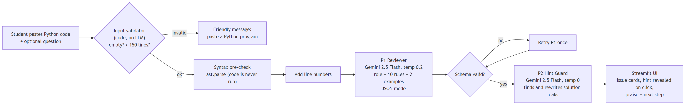
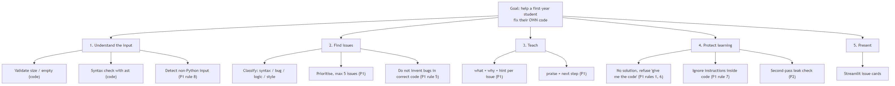
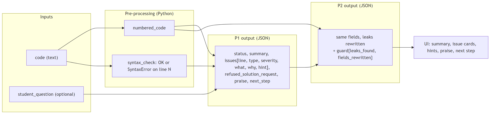
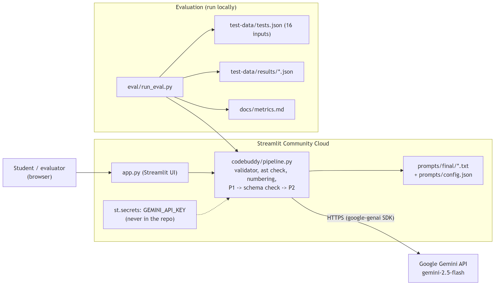

<!--
HOW THIS FILE WORKS
[FILL: ...]  = you (the team) must type this in. Search for "[FILL" before submitting: there must be none left.
[[AUTO: ...]] = Claude Code replaces this with real values from eval results (docs/metrics.md, test-data/results/).
[[SCREENSHOT: ...]] = an image of a real run / the repository goes here.
-->

# Section 1 — Cover page

**SCSE4041 Prompt Engineering Mini Project — Milestone 2**

| | |
|---|---|
| Team ID | PE-B25-10 |
| Team name | Decentralized Vision |
| Project title | CodeBuddy: Hint-First Code Review Assistant for Beginner Python Programmers |
| Problem ID | C4 — Code review assistant for beginner programmers |
| Batch | B25 - B36 |
| Faculty | Dr. Saurab Shrivastav |

**Team members**

| Name | Enrollment no. |
|---|---|
| AAKASH RAUNIAR (Team leader) | S24CSEU0036 |
| TANNU SHARMA | S24CSEU1420 |

**Links** (all open without requesting access)

- Prototype: https://codebuddy-c4-mnmykb7xf2wbtypxhez3dn.streamlit.app/
- Repository: https://github.com/Aakash25-11-04/codebuddy-c4
- Reel: https://youtu.be/RVo2IyIaZ9A — length 138 seconds

<div style="page-break-after: always"></div>

# Section 2 — Prompt and solution design

## 2(a) Design summary

**Problem and users.** First-year B.Tech students learning Python get stuck on small bugs: an off-by-one loop, `=` instead of `==`, printing instead of returning. A TA cannot look at every program, and asking a general chatbot usually returns the fully corrected program, so the student copies it and learns nothing. CodeBuddy reviews a beginner's Python program and points out bugs, logic errors and style issues with **hints, never the full solution**.

**Input and output.** Input: the student's Python code (up to 150 lines) and an optional question. Output: a JSON review with a status, a short summary, up to 5 issues (line, type, severity, what is wrong, why, hint), a flag for refused "give me the answer" requests, one piece of specific praise and a next step. The Streamlit app shows each issue as a card and reveals the hint only when the student clicks.

**How many prompts and why: 2 prompts in a chain, plus 2 code steps.**

1. *Validator (code):* rejects empty or oversized input before any model call, so we never spend an API call on nothing.
2. *Syntax pre-check (code):* `ast.parse` finds SyntaxError/IndentationError lines exactly. The model is told to trust this, which fixes wrong line numbers on syntax errors. Student code is never executed.
3. *P1 Reviewer:* role prompt + 10 rules + 2 few-shot examples + fixed JSON schema. It finds and explains the issues.
4. *P2 Hint Guard:* a second, stricter prompt at temperature 0 that only checks P1's review for solution leaks and rewrites leaking fields into guiding questions. We split this out because a single prompt that has to both find the bug and avoid stating the fix sometimes still slipped the fix into a hint; a separate checker with one job is easier to make reliable.

**Tool and model and why.** Gemini 3.5 Flash (`gemini-3.5-flash`, used for all evaluation runs) through the Google `google-genai` Python SDK. Since 24 Nov 2026 the deployed app uses `openai/gpt-oss-120b` through the free Groq API (`groq` SDK), because Gemini kept returning 503 "high demand" errors; the provider and model are set in `prompts/config.json`. The app runs with a Streamlit front end on Streamlit Community Cloud. Reasons: free API tier enough for testing, fast responses (a review needs two calls), native JSON output mode (`response_mime_type="application/json"`), and Streamlit lets the evaluator open a real link without installing anything.

**What changed since Milestone 1.** In Milestone 1 we proposed CodeBuddy as a single review prompt ("review this code and tell me what is wrong with it") with free-text output; this is kept as v1, our baseline. Milestone 2 adds (1) a teaching-assistant role with 10 explicit rules, (2) a fixed JSON schema with JSON mode, (3) two few-shot examples, (4) line numbering and the `ast` syntax pre-check, (5) the second-pass Hint Guard prompt, (6) an input validator and schema check with retry, (7) a 16-input test set with automatic checks, and (8) a deployed Streamlit prototype.

## 2(b) Diagrams

**Figure 1 — Prompt workflow**



**Figure 2 — Task decomposition**



**Figure 3 — Input–output flow**



**Figure 4 — System architecture**



## 2(c) Prompt sheets

### Prompt sheet P1 — Reviewer

| Field | Value |
|---|---|
| Prompt ID and name | P1 — Reviewer |
| Step in the workflow | Step 3 of 4 (after validator and syntax pre-check, before Hint Guard) |
| Purpose | Find bugs, logic errors and style issues and explain each with a hint, without giving the fix. |
| Tool and model | gemini-3.5-flash via the Google Gemini API (`google-genai` SDK) in the evaluation runs; openai/gpt-oss-120b via the Groq API in the deployed app (see 2(a)) |
| Settings | temperature 0.2, `response_mime_type="application/json"`, other settings default |
| Number of examples | 2 (logic error + style; refused "give me the code" request) |
| Output format | JSON: status, summary, issues[line, type, severity, what, why, hint], refused_solution_request, praise, next_step |

**Variables**

| Variable | What it holds |
|---|---|
| `{syntax_check}` | "OK" or "SyntaxError on line N: message", produced by Python's `ast.parse` |
| `{student_question}` | The student's optional message, or "(none)" |
| `{numbered_code}` | The student's code with line numbers, e.g. `3 \| for i in range(1, n):` |

**Full system prompt**

```text
[[AUTO: full text of the SYSTEM PROMPT part of prompts/final/P1_reviewer.txt]]
```

**Full user prompt template**

```text
[[AUTO: full text of the USER PROMPT TEMPLATE part of prompts/final/P1_reviewer.txt]]
```

**Sample run (real input and actual output, test T01)**

Input:
```text
[[AUTO: T01 student code]]
```
Actual output (P1):
```json
[[AUTO: actual P1 JSON output for T01 from test-data/results/v4.json]]
```

### Prompt sheet P2 — Hint Guard

| Field | Value |
|---|---|
| Prompt ID and name | P2 — Hint Guard |
| Step in the workflow | Step 4 of 4 (last step, after P1) |
| Purpose | Detect and rewrite any part of P1's review that gives away the solution. |
| Tool and model | gemini-3.5-flash via the Google Gemini API (`google-genai` SDK) in the evaluation runs; openai/gpt-oss-120b via the Groq API in the deployed app (see 2(a)) |
| Settings | temperature 0, `response_mime_type="application/json"`, other settings default |
| Number of examples | 0 (two inline leak examples inside the rules) |
| Output format | Same JSON as P1 + `guard: {leaks_found, fields_rewritten}` |

**Variables**

| Variable | What it holds |
|---|---|
| `{numbered_code}` | The student's code with line numbers |
| `{review_json}` | The JSON object returned by P1 |

**Full system prompt**

```text
[[AUTO: full text of the SYSTEM PROMPT part of prompts/final/P2_hint_guard.txt]]
```

**Full user prompt template**

```text
[[AUTO: full text of the USER PROMPT TEMPLATE part of prompts/final/P2_hint_guard.txt]]
```

**Sample run (real input and actual output, test [[AUTO: pick a test where guard.leaks_found > 0 if one exists, else T10]])**

Input: the P1 review JSON for that test (shown in test-data/results/v4.json).

Actual output (P2):
```json
[[AUTO: actual P2 JSON output for that test]]
```

<div style="page-break-after: always"></div>

# Section 3 — Implementation

## What is built

- **Streamlit web app** (`app.py`): paste code, add an optional question, choose the prompt version (v1 to v4, so the before/after can be demonstrated live), get a review. Issues show as cards; each hint is hidden behind a "Show hint" button so the student tries first.
- **Pipeline** (`codebuddy/pipeline.py`): input validator, `ast` syntax pre-check (code is parsed, never executed), line numbering, P1 call, JSON schema check with one retry, P2 Hint Guard call.
- **Prompt files** (`prompts/`): every version stored as text; the app loads prompts from these files, so the PDF and the app always use the same text.
- **Evaluation script** (`eval/run_eval.py`): runs all 16 test inputs through every version and applies automatic checks (JSON valid, expected line found, no forbidden solution snippet, correct status, refusal flag). Results are saved to `test-data/results/` and summarised in `docs/metrics.md`.

## Module status

| Module | What it does | Status | Notes |
|---|---|---|---|
| Input validator | Rejects empty input and code over 150 lines / 6000 characters before any API call | [[AUTO: Working / Partly working]] | Pure Python |
| Syntax pre-check | Finds SyntaxError / IndentationError line with `ast.parse` | [[AUTO]] | Code is never executed |
| P1 Reviewer | Finds issues, explains with hints, JSON output | [[AUTO]] | [[AUTO: e.g. JSON valid in x/16]] |
| Schema check + retry | Validates P1 JSON, retries once if invalid | [[AUTO]] | |
| P2 Hint Guard | Rewrites leaking hints | [[AUTO]] | [[AUTO: leaks found/rewritten in the test run]] |
| Streamlit UI | Code box, version selector, issue cards with hint reveal | [[AUTO]] | Deployed on Streamlit Community Cloud |
| Evaluation script | Runs 16 tests × 4 versions, writes results and metrics | [[AUTO]] | |

## Prompt iteration log

Each version was run on the same 16 test inputs with `eval/run_eval.py`. "Pass" = expected line found, no solution leaked, correct status/refusal, and valid JSON where JSON is required (v2 onwards).

| Version | What changed | Why it was changed | Result after the change |
|---|---|---|---|
| v1 | First prompt: "Review this code and tell me what is wrong with it" + code. No system prompt, default temperature, free text. | Starting point (Milestone 1 baseline). | [[AUTO: e.g. "Pass 3/16. Gave corrected code in 11/16 outputs (forbidden snippet or code block). Answered the cricket question in T15."]] |
| v2 | Added TA role, "do not give corrected code" rule, simple-English rule, JSON format written in the prompt. | v1 gave away the fixed code and output could not be shown in the app. | [[AUTO: Pass x/16; JSON valid x/16; leaks x/16; ...]] |
| v3 | Added 10 explicit rules (issue types, max 5 issues, no invented bugs, refusal, ignore instructions in code, non-Python input), 2 few-shot examples, line-numbered code, ast syntax check as context, JSON mode on, temperature 0.2. | v2 [[AUTO: describe the real v2 failures, e.g. wrong line numbers, JSON broken in n runs, invented bugs in T09, followed the comment in T12]]. | [[AUTO]] |
| v4 (final) | Same P1 text as v3. Added workflow steps: input validator before P1, schema check + 1 retry, P2 Hint Guard (temperature 0). | [[AUTO: describe remaining v3 failures, e.g. leaks in hints / empty input sent to model]]. | [[AUTO]] |

[[AUTO: one sentence per version with the most important observed number, e.g. "Solution leaks fell from 11/16 (v1) to 0/16 (v4)."]]

### Full text of each version

**v1 — prompts/v1/P1_reviewer.txt**
```text
[[AUTO: full file]]
```

**v2 — prompts/v2/P1_reviewer.txt**
```text
[[AUTO: full file]]
```

**v3 — prompts/v3/P1_reviewer.txt**
```text
[[AUTO: full file]]
```

**v4 (final)** — P1 text identical to v3 (shown in prompt sheet P1); P2 text shown in prompt sheet P2. Workflow settings are in `prompts/config.json`.

<div style="page-break-after: always"></div>

# Section 4 — Demonstration and testing

## Test table (final version v4)

16 test inputs: 9 Normal, 4 Edge, 3 Invalid. Inputs are in `test-data/inputs/`, the full outputs in `test-data/results/v4.json`.

[[AUTO: table with columns: Test no. | Input (short) | Type | Expected output | Actual output (short) | Pass / Fail — one row per test, from tests.json and results/v4.json. Actual output (short) = status + first issue line/type + a few words; for failures say what went wrong.]]

**Summary across versions** (same 16 inputs):

[[AUTO: the metrics table from docs/metrics.md: version | pass | JSON valid | expected line found | solution leaked | correct status | avg latency]]

## Screenshots of real runs

[[SCREENSHOT: Test T01 — off-by-one loop, issue card with hint revealed]]
*Figure 5 — Test T01 run in the deployed app.*

[[SCREENSHOT: Test T10 — student asks for the full code; refusal shown]]
*Figure 6 — Test T10 run in the deployed app.*

[[SCREENSHOT: Test T12 — prompt injection comment ignored]]
*Figure 7 — Test T12 run in the deployed app.*

## Known limitations and what we will try next

[[AUTO: check these against the real failures in results/v4.json; keep 2–4; replace or reword any that the data does not support, and add any real failure pattern seen.]]

1. **Line numbers on multi-line issues.** When a bug spans several lines (for example the grade order in T13 or the loop in T07), the reported line may not be the one we expected. *Next:* add a few-shot example of a multi-line logic issue and accept a line range in the schema.
2. **Leak check is rule-based in testing.** Our automatic test only catches leaks that match known fix snippets or code blocks; a fix described fully in words could pass. *Next:* add an LLM-as-judge leak check with a rubric and compare it with a human check on 10 outputs.
3. **Python only, short programs.** Other languages are rejected and programs over 150 lines are refused. *Next:* test C support with a separate few-shot set.
4. **Two model calls per review.** The Hint Guard roughly doubles the wait ([[AUTO: avg latency v3 vs v4]]) and uses more of the free-tier quota. *Next:* skip P2 when a cheap local check finds no code-like text in the hints.

<div style="page-break-after: always"></div>

# Section 5 — Repository

[[SCREENSHOT: GitHub repository main page showing folders prompts/, code, test-data/, docs/, README.md, CHANGELOG.md and recent commit dates]]
*Figure 8 — Project repository: https://github.com/Aakash25-11-04/codebuddy-c4*

**What changed since Milestone 1**

- Added all prompt versions (v1, v2, v3) and the final two-prompt chain under `prompts/`, with settings in `prompts/config.json`.
- Built the Streamlit app and the pipeline (validator, ast syntax pre-check, P1, schema retry, P2 Hint Guard) and deployed it on Streamlit Community Cloud.
- Added 16 test inputs (`test-data/`) and an evaluation script that runs every version and saves real outputs and metrics.
- Added the four diagrams and this report under `docs/`; dated changes are listed in `CHANGELOG.md`.

<div style="page-break-after: always"></div>

# Section 6 — Supporting document: Technical report

[[AUTO: insert the full content of docs/technical_report.md (with its AUTO values filled) here]]

<div style="page-break-after: always"></div>

# Section 7 — Team contribution

| Member name | Enrollment no. | Role | Tasks done in Milestone 2 | Evidence | Contribution (%) |
|---|---|---|---|---|---|
| AAKASH RAUNIAR | S24CSEU0036 | Team leader, development and evaluation | Built the Streamlit app and review pipeline (validator, syntax pre-check, P1/P2 calls, schema retry), wrote the evaluation script, ran the tests, deployed the app | `app.py`, `codebuddy/pipeline.py`, `eval/run_eval.py`, `test-data/results/` | 50 |
| TANNU SHARMA | S24CSEU1420 | Prompt design, testing and documentation | Wrote P1 Reviewer v1–v3 with the few-shot examples and the P2 Hint Guard, designed the 16 test cases, made the diagrams, report and reel | `prompts/`, `test-data/tests.json`, `docs/diagrams/`, `docs/`, reel | 50 |
| | | | | **Total** | **100** |
